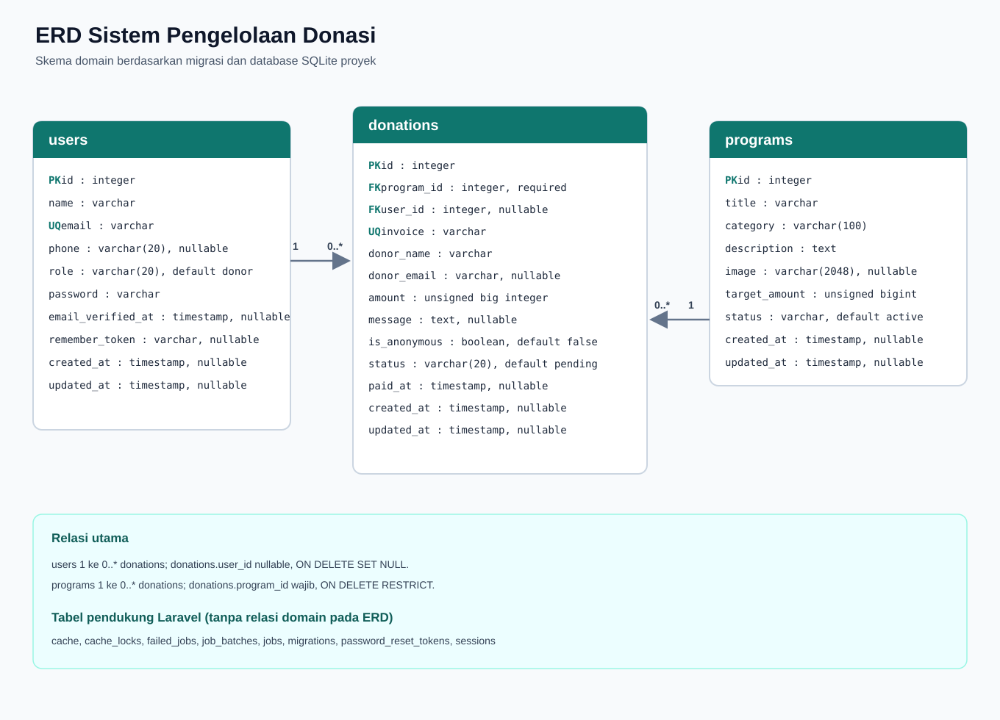

<!-- Logo Laravel ditampilkan di bagian tengah halaman -->
<p align="center"><a href="https://laravel.com" target="_blank"></a></p>

<!-- Menampilkan informasi status build, jumlah unduhan, versi terbaru, dan lisensi Laravel -->
<p align="center">
<a href="https://github.com/laravel/framework/actions"></a>
<a href="https://packagist.org/packages/laravel/framework"></a>
<a href="https://packagist.org/packages/laravel/framework"></a>
<a href="https://packagist.org/packages/laravel/framework"></a>
</p>

## Backend Donasi

Backend menyimpan akun donatur, program, dan transaksi donasi di database. Untuk
menggunakan proyek secara lokal, clone repositori lalu jalankan perintah berikut
dari PowerShell:

```powershell
git clone https://github.com/khafifreza/Kelompok-5-Sistem-Pengelolaan-Donasi.git
Set-Location Kelompok-5-Sistem-Pengelolaan-Donasi

if (-not (Test-Path .env)) {
    Copy-Item .env.example .env
}

composer install

if (-not (Test-Path database\database.sqlite)) {
    New-Item -ItemType File -Path database\database.sqlite | Out-Null
}

php artisan key:generate
php artisan migrate
```

Jika ingin mengisi data contoh, jalankan seeder:

```powershell
php artisan db:seed
```

Jangan commit file `.env` karena berisi konfigurasi lokal. Sesuaikan nilainya
sendiri jika memakai database selain SQLite.

### ERD Database



ERD inti terdiri dari tiga tabel:

- `users` menyimpan akun donatur dan admin.
- `programs` menyimpan program penggalangan dana.
- `donations` menyimpan transaksi dan menghubungkan program dengan donatur.

Satu `program` dapat memiliki banyak `donations`, tetapi setiap donasi wajib
terhubung ke satu program. Karena donasi tamu diperbolehkan, `donations.user_id`
bersifat nullable; satu pengguna dapat memiliki nol atau banyak donasi.
Penghapusan pengguna akan mengosongkan `user_id` pada donasinya (`SET NULL`),
sedangkan program yang masih memiliki donasi tidak dapat dihapus (`RESTRICT`).
Nama dan email donatur disimpan pada transaksi agar riwayat donasi tetap
mempertahankan data saat transaksi dibuat.

Tabel pendukung Laravel seperti cache, queue, sesi, dan reset password tidak
memiliki relasi foreign key domain pada ERD ini. Lihat [tabel dan relasi
database](docs/database-relations.md) untuk rincian kolom dan indeks.

Donasi baru berstatus `pending`. Admin yang sudah login dapat mengubahnya menjadi
`success` atau `failed`; konfirmasi pembayaran otomatis mencatat waktu `paid_at`.
Akun yang mendaftar mendapat peran `donor`. Untuk memberi akses admin, daftarkan
akun terlebih dahulu, lalu ubah perannya melalui Tinker:

```bash
php artisan tinker --execute="App\Models\User::where('email', 'admin@example.com')->update(['role' => 'admin']);"
```

Rute dashboard donatur memerlukan login. Semua rute di bawah `/admin` memerlukan
login dan peran admin. Integrasi payment gateway belum tersedia; status donasi
perlu diperbarui oleh admin.

## Alur Branch, Pull Request, dan Merge

Mulai dari branch `main` terbaru, lalu buat branch khusus untuk setiap perubahan.
Gunakan awalan `feature/` untuk fitur atau `fix/` untuk perbaikan:

```bash
git switch main
git pull --ff-only origin main
git switch -c feature/nama-perubahan
```

Setelah perubahan selesai, jalankan pemeriksaan yang sesuai, lalu commit dan
push branch tersebut:

```bash
git status
git add <file-yang-diubah>
git commit -m "Jelaskan perubahan"
git push -u origin feature/nama-perubahan
```

Di GitHub, buat Pull Request dengan branch tujuan (`base`) `main` dan branch
perubahan (`compare`) yang baru saja di-push. Jelaskan tujuan perubahan, cara
menguji, serta hasil pemeriksaan. Tanggapi masukan reviewer dan pastikan
pemeriksaan wajib lulus sebelum merge. Jika ada konflik, selesaikan di branch
perubahan, jalankan ulang pemeriksaan, lalu push kembali.

Setelah Pull Request di-merge sesuai kebijakan tim, perbarui branch lokal dan
hapus branch kerja yang sudah selesai:

```bash
git switch main
git pull --ff-only origin main
git branch -d feature/nama-perubahan
```

## About Laravel

<!-- Bagian ini menjelaskan pengertian Laravel dan fitur-fitur utama yang disediakan oleh framework Laravel -->

Laravel, is a web application framework with expressive, elegant syntax. We believe development must be an enjoyable and creative experience to be truly fulfilling. Laravel takes the pain out of development by easing common tasks used in many web projects, such as:

<!-- Daftar fitur utama Laravel yang membantu proses pengembangan aplikasi web -->
- [Simple, fast routing engine](https://laravel.com/docs/routing).
- [Powerful dependency injection container](https://laravel.com/docs/container).
- Multiple back-ends for [session](https://laravel.com/docs/session) and [cache](https://laravel.com/docs/cache) storage.
- Expressive, intuitive [database ORM](https://laravel.com/docs/eloquent).
- Database agnostic [schema migrations](https://laravel.com/docs/migrations).
- [Robust background job processing](https://laravel.com/docs/queues).
- [Real-time event broadcasting](https://laravel.com/docs/broadcasting).

<!-- Laravel menyediakan berbagai fitur untuk membangun aplikasi berskala kecil hingga besar -->
Laravel is accessible, powerful, and provides tools required for large, robust applications.

## Learning Laravel

<!-- Bagian ini berisi referensi pembelajaran Laravel melalui dokumentasi resmi dan platform tutorial -->
Laravel has the most extensive and thorough [documentation](https://laravel.com/docs) and video tutorial library of all modern web application frameworks, making it a breeze to get started with the framework.

<!-- Laracasts menyediakan video pembelajaran mengenai Laravel, PHP, pengujian aplikasi, dan JavaScript -->
In addition, [Laracasts](https://laracasts.com) contains thousands of video tutorials on a range of topics including Laravel, modern PHP, unit testing, and JavaScript. Boost your skills by digging into our comprehensive video library.

<!-- Laravel Learn menyediakan materi pembelajaran singkat berbasis proyek nyata -->
You can also watch bite-sized lessons with real-world projects on [Laravel Learn](https://laravel.com/learn), where you will be guided through building a Laravel application from scratch while learning PHP fundamentals.

## Agentic Development

<!-- Bagian ini menjelaskan penggunaan AI coding agent untuk membantu proses pengembangan aplikasi Laravel -->
Laravel's predictable structure and conventions make it ideal for AI coding agents like Claude Code, Cursor, and GitHub Copilot. Install [Laravel Boost](https://laravel.com/docs/ai) to supercharge your AI workflow:

<!-- Perintah untuk memasang Laravel Boost sebagai dependensi pengembangan -->
```bash
# Memasang Laravel Boost sebagai dependensi development menggunakan Composer
composer require laravel/boost --dev

# Menjalankan instalasi Laravel Boost melalui Artisan
php artisan boost:install
```

<!-- Laravel Boost menyediakan berbagai tools dan skills untuk membantu AI agent mengikuti standar pengembangan Laravel -->
Boost provides your agent 15+ tools and skills that help agents build Laravel applications while following best practices.

## Contributing

<!-- Bagian ini memberikan informasi mengenai cara berkontribusi dalam pengembangan framework Laravel -->
Thank you for considering contributing to the Laravel framework! The contribution guide can be found in the [Laravel documentation](https://laravel.com/docs/contributions).

## Code of Conduct

<!-- Bagian ini menjelaskan pedoman perilaku yang harus dipatuhi oleh komunitas Laravel -->
Thank you for considering contributing to the Laravel framework! Please review and abide by the [Code of Conduct](https://laravel.com/docs/contributions#code-of-conduct).

## Security Vulnerabilities

<!-- Bagian ini menjelaskan prosedur pelaporan apabila ditemukan celah keamanan pada framework Laravel -->
If you discover a security vulnerability within Laravel, please send an e-mail to Taylor Otwell via [taylor@laravel.com](mailto:taylor@laravel.com). All security vulnerabilities will be promptly addressed.

## License

<!-- Bagian ini menjelaskan lisensi MIT yang digunakan oleh framework Laravel -->
The Laravel framework is open-sourced software licensed under the [MIT license](https://opensource.org/licenses/MIT).
