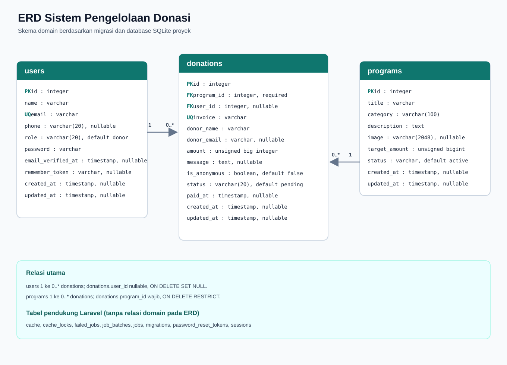

# ERD dan Relasi Database

ERD ini mencerminkan skema database proyek saat ini. Tabel domain dan foreign
key-nya berasal dari migrasi Laravel; database lokal yang diperiksa menggunakan
SQLite.
Tipe pada tabel mengikuti deklarasi migrasi; SQLite menyimpan kolom
`unsignedBigInteger` sebagai `integer`.

## Tabel Domain

### `users`

| Kolom | Tipe | Keterangan |
| --- | --- | --- |
| `id` | integer | Primary key |
| `name` | varchar | Nama pengguna |
| `email` | varchar | Wajib dan unik |
| `phone` | varchar(20) | Nullable |
| `role` | varchar(20) | Default `donor` |
| `password` | varchar | Password ter-hash |
| `email_verified_at` | timestamp | Nullable |
| `remember_token` | varchar | Nullable |
| `created_at`, `updated_at` | timestamp | Nullable; dikelola Laravel |

### `programs`

| Kolom | Tipe | Keterangan |
| --- | --- | --- |
| `id` | integer | Primary key |
| `title` | varchar | Judul program |
| `category` | varchar(100) | Kategori |
| `description` | text | Deskripsi program |
| `image` | varchar(2048) | Nullable |
| `target_amount` | unsigned big integer | Target donasi |
| `status` | varchar(20) | Default `active`; memiliki indeks |
| `created_at`, `updated_at` | timestamp | Nullable; dikelola Laravel |

### `donations`

| Kolom | Tipe | Keterangan |
| --- | --- | --- |
| `id` | integer | Primary key |
| `program_id` | unsigned big integer | Foreign key wajib ke `programs.id` |
| `user_id` | unsigned big integer | Foreign key nullable ke `users.id` |
| `invoice` | varchar | Wajib dan unik |
| `donor_name` | varchar | Nama donatur yang disimpan pada transaksi |
| `donor_email` | varchar | Nullable |
| `amount` | unsigned big integer | Nominal donasi |
| `message` | text | Nullable |
| `is_anonymous` | boolean | Default `false` |
| `status` | varchar(20) | Default `pending`; memiliki indeks |
| `paid_at` | timestamp | Nullable; memiliki indeks |
| `created_at`, `updated_at` | timestamp | Nullable; dikelola Laravel |

Indeks tambahan yang dibuat untuk relasi dan query aplikasi:

- `donations.user_id`
- `donations(program_id, status)`
- `donations.created_at`
- `programs.created_at`

## Tabel Relasi

| Tabel induk | Tabel anak | Kardinalitas | Foreign key | Aturan penghapusan |
| --- | --- | --- | --- | --- |
| `users` | `donations` | Satu pengguna memiliki nol atau banyak donasi; satu donasi dapat tanpa akun pengguna | `donations.user_id` -> `users.id` | `SET NULL` |
| `programs` | `donations` | Satu program memiliki nol atau banyak donasi; setiap donasi harus memiliki satu program | `donations.program_id` -> `programs.id` | `RESTRICT` |

`donor_name` dan `donor_email` pada `donations` menyimpan data donatur pada saat
transaksi dibuat. Karena itu, donasi tetap menyimpan identitas transaksi ketika
akun pengguna dihapus; `user_id` akan menjadi `NULL`.

## Tabel Pendukung Laravel

Tabel berikut ada untuk infrastruktur Laravel dan tidak memiliki foreign key
domain pada skema proyek:

| Tabel | Kegunaan |
| --- | --- |
| `cache`, `cache_locks` | Cache dan penguncian cache |
| `jobs`, `job_batches`, `failed_jobs` | Queue, batch job, dan job gagal |
| `migrations` | Catatan migrasi yang telah dijalankan |
| `password_reset_tokens` | Token reset password |
| `sessions` | Data sesi aplikasi; `user_id` hanya berindeks, bukan foreign key |
